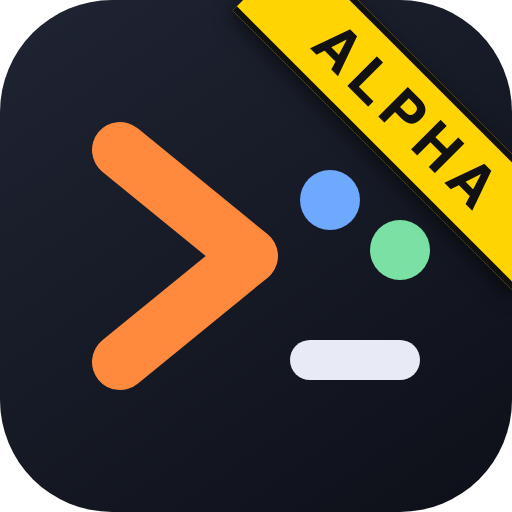

<div align="center">




# claude-jam

**⚠️ ALPHA — not fully tested, and not everything works yet. Expect bugs and breaking changes. [Help build it →](CONTRIBUTING.md)**

### Share one real Claude Code session with other humans, live over WebSockets.

The host keeps the native `claude` TUI: their own plugins, skills, MCP servers, `CLAUDE.md`, hooks and
account. Guests join from a terminal. The agent sees **who wrote each message**, and humans get a side
channel the agent never sees.

[](https://github.com/roypadina/claude-jam/releases/latest)
[](https://www.npmjs.com/package/@roypadina/claude-jam)
[](https://github.com/roypadina/claude-jam/actions/workflows/tests.yml)
[](https://github.com/roypadina/claude-jam/actions/workflows/tests.yml)
[](https://nodejs.org)
[](https://apps.roypadina.synology.me/apps/claude-jam/)
[](LICENSE)
[](docs/ROADMAP.md)
[](CONTRIBUTING.md)
[](https://ko-fi.com/roypadina)

</div>

---

## Status: alpha

> **claude-jam is alpha software, and it is looking for contributors.**
>
> - **Works:** hosting on macOS (verified every release), joining from macOS, Linux and Windows terminals,
>   attributed messages, the side channel, invites and approvals, tunnels via cloudflared, a 479-test unit suite plus CI on macOS, Linux and Windows.
> - **Rough:** the Linux host and the WSL2 host are thinly proven or never run on a real machine; Windows
>   keys, toasts and sounds are unverified; `--funnel` is unverified; discovery (`find`) is macOS-only.
> - **Expect breaking changes** to flags, invite links and the wire protocol until 1.0.
>
> Details, with dates, in [docs/COMPATIBILITY.md](docs/COMPATIBILITY.md). Plan in [docs/ROADMAP.md](docs/ROADMAP.md).

## Quickstart

```sh
brew install roypadina/tap/claude-jam      # or: npm i -g @roypadina/claude-jam
claude-jam host --name Alice --cwd .       # host: start a jam in this directory
claude-jam join <invite-link-or-ws-url>    # guest: the host sends you the link, privately
```

Mint a link for one person with `claude-jam invite Dana`. Bare `claude-jam` opens a menu.

## Why

Claude Code's Remote Control is one account. tmux or screen-share has no idea who typed what.
claude-jam keeps **one real interactive session**, bridges it to several people, and makes the agent
aware of the room.

- **It is the real TUI, not a wrapper.** The host's `claude` runs in tmux with their own setup;
  guests watch it streamed live and type into it.
- **Attributed messages.** Every participant, host included, reaches the agent as `[Name]: ...`.
- **A human-only side channel.** `/c` messages are never injected into the session.
- **Admission you control.** Token, knock-and-approve, single-use invite links; the host approves
  tool permissions and file uploads.
- **Works across the network.** LAN, Tailscale, a Cloudflare tunnel, or Tailscale Funnel. Guests
  need only Node 22.
- **Peer tasks.** The host's agent can ask a guest's own Claude Code to do a job, with the guest's
  consent and on the guest's own quota.

## Requirements

- **Node 22 or later.** The host also needs `tmux` and the `claude` CLI on `PATH`.
- Optional: `ttyd` (browser view), `cloudflared` (`--tunnel`), `tailscale` (`--funnel`), `git` (`/diff`).

| Platform | Host | Join as guest |
|---|---|---|
| macOS | verified on every release | verified |
| Linux | supported, thinly proven (lifecycle smoke 19/19 on Debian, CI leg) | CI-tested |
| Windows | via WSL2 only, integrated but not yet run on a real WSL install | native client CI-tested; a jam has been joined from a WSL2 client |

Row-by-row evidence, with dates, is in [docs/COMPATIBILITY.md](docs/COMPATIBILITY.md).

## Help build it

claude-jam needs people on platforms the maintainer cannot test. You do not have to write code.

1. Read [CONTRIBUTING.md](CONTRIBUTING.md) (setup, tests, layout, PR flow).
2. Pick an issue: [good first issue](https://github.com/roypadina/claude-jam/labels/good%20first%20issue) ·
   [help wanted](https://github.com/roypadina/claude-jam/labels/help%20wanted).
3. See where the project is going: [docs/ROADMAP.md](docs/ROADMAP.md).
4. Questions or ideas: [Discussions](https://github.com/roypadina/claude-jam/discussions).

Running it on Windows, WSL2 or a Linux desktop and reporting what happened is a real contribution.

## Documentation

The full guide (every command, access mode, peer tasks, internals) lives in the
**[wiki](https://github.com/roypadina/claude-jam/wiki)**: start with the
[Full Guide](https://github.com/roypadina/claude-jam/wiki/Full-Guide),
[Hosting a Jam](https://github.com/roypadina/claude-jam/wiki/Hosting-a-Jam) and
[Security Model](https://github.com/roypadina/claude-jam/wiki/Security-Model).
Contributors: [AGENTS.md](AGENTS.md), [SPEC.md](SPEC.md), [TESTING.md](TESTING.md),
[PRIOR-ART.md](PRIOR-ART.md).

## More Mac apps by Roy

Free, open-source Mac menu-bar apps and terminal tools, all on one site: **[apps.roypadina.synology.me](https://apps.roypadina.synology.me/)**.

- [Agents Monitor](https://apps.roypadina.synology.me/apps/agents-monitor/) — See your Claude Code and Codex usage limits before you hit them.
- [AgentsSessionHopper](https://apps.roypadina.synology.me/apps/agents-session-hopper/) — Profiles for Claude Code. One conversation, any of your accounts.
- [agentctl](https://apps.roypadina.synology.me/apps/agentctl/) — Find and resume any Claude Code or Codex session from one terminal menu.

## Support

If claude-jam lets you share a Claude Code session with the people you work with, you can support its development. It is optional and always appreciated.

[](https://ko-fi.com/roypadina)

A star on the repo helps just as much.

## License

MIT, see [LICENSE](LICENSE).

Made by Roy Padina · [Support on Ko-fi](https://ko-fi.com/roypadina)
